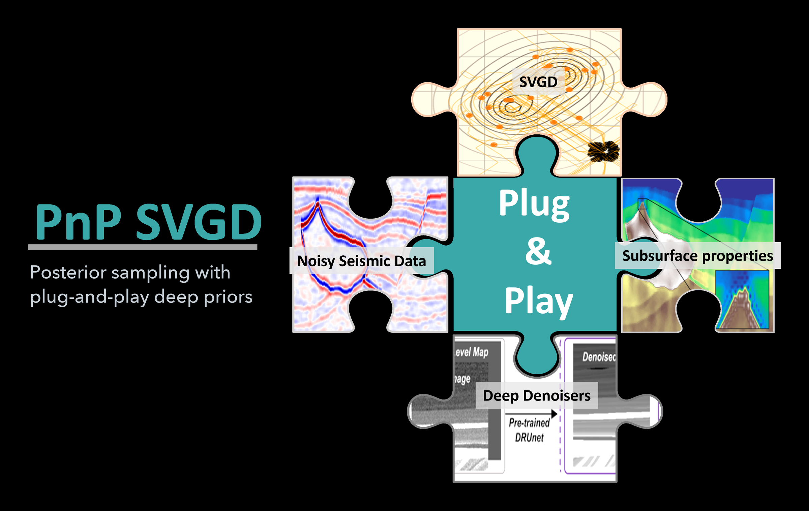
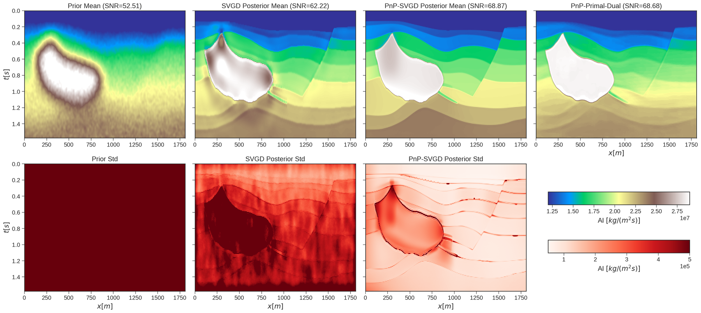
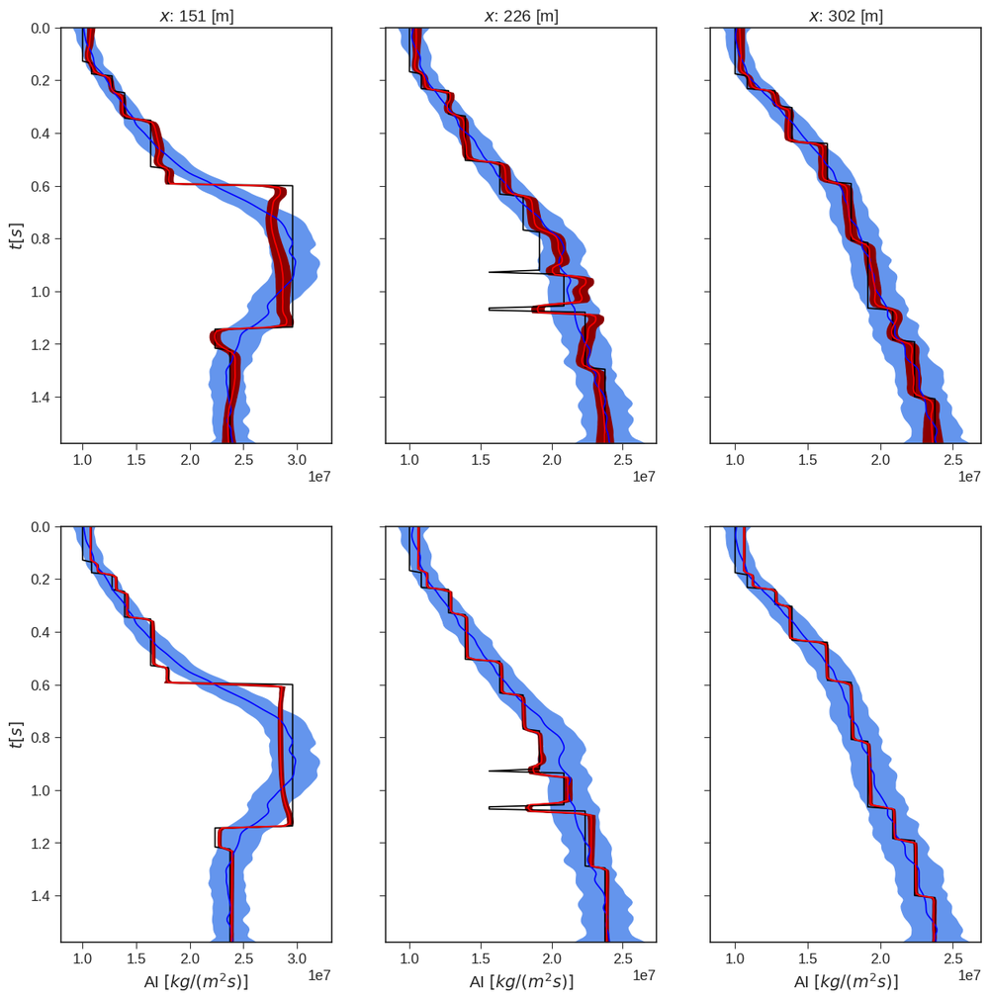
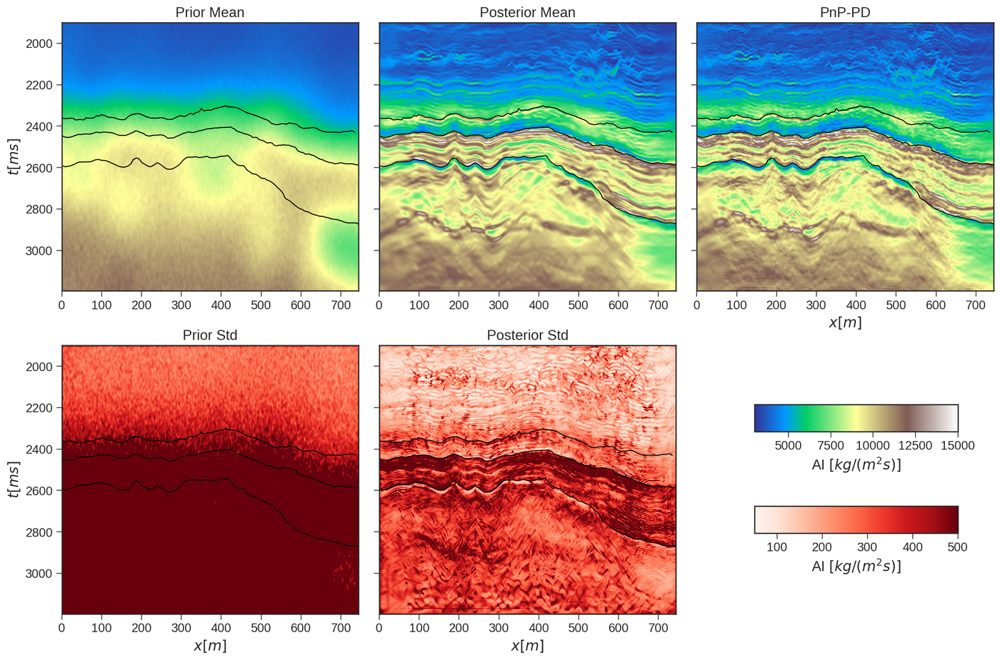

<p align="center">
  
</p>

<p align="center">
  <a href="https://doi.org/10.1190/geo2023-0035.1"></a>
  <a href="https://arxiv.org/abs/2212.14595"></a>
  
  
</p>

PnP-SVGD estimates the posterior distribution of an inverse problem with a set of particles. Each iteration moves the particles with Stein variational gradient descent (SVGD), then passes every particle through a pretrained convolutional denoiser. The denoiser acts as the prior, so the samples keep realistic geological structure without anyone writing that prior down as a density.

This repository contains the code and notebooks for the paper below. The examples invert post-stack seismic data for acoustic impedance, with the forward model built in [PyLops](https://pylops.readthedocs.io).

> Izzatullah, M., Alkhalifah, T., Romero, J., Corrales, M., Luiken, N., and Ravasi, M. (2024). Posterior sampling with convolutional neural network-based plug-and-play regularization with applications to poststack seismic inversion. *Geophysics*, 89(2), R137. https://doi.org/10.1190/geo2023-0035.1

## Results

<p align="center">
  
</p>

Synthetic Hess model. The top row shows the prior mean, the posterior means from plain SVGD and from PnP-SVGD, and a deterministic plug-and-play primal-dual estimate. The bottom row shows the matching standard deviations. The denoiser raises the SNR of the posterior mean from 62.22 to 68.87, sharpens the salt body and layer boundaries, and concentrates the uncertainty along the salt boundary and the interfaces.

<p align="center">
  
</p>

Acoustic impedance at three lateral positions. Black is the true model, blue the prior mean with one standard deviation, and red the posterior mean with one standard deviation: plain SVGD in the top row, PnP-SVGD in the bottom row.

<p align="center">
  
</p>

Volve field data. The top row shows the prior mean, the PnP-SVGD posterior mean and a plug-and-play primal-dual estimate. The bottom row shows the prior and posterior standard deviations. Black lines are horizons.

## Installation

The notebooks need conda and a CUDA GPU. The install script downloads the DRUNet weights into `models/`, creates the `pnpsvgd` environment from `environment.yml`, and checks that PyTorch can see the GPU.

```bash
git clone https://github.com/izzatum/PnP-SVGD.git
cd PnP-SVGD
./install_env.sh
conda activate pnpsvgd
pip install -e .
```

If the weight download fails, get `drunet_gray.pth` from the [pretrained model folder](https://drive.google.com/drive/folders/1uEYx0GR4D7q5UMsc1qFVW1KeyVYI_hE-?usp=sharing) and place it in `models/`. The paper's experiments ran on one NVIDIA Tesla V100 GPU with an Intel Xeon Platinum 8260 CPU.

## Notebooks

| Notebook | Data | What it covers |
|---|---|---|
| [Example-1-Hess-Model.ipynb](notebooks/Example-1-Hess-Model.ipynb) | Synthetic Hess VTI model, `data/timodel_vp.segy` | SVGD, PnP-SVGD and plug-and-play primal-dual compared; posterior samples, uncertainty and convergence |
| [Example-2-Volve-Model.ipynb](notebooks/Example-2-Volve-Model.ipynb) | Volve field data, `data/Volve2dfence_NO_15_9-19_BT2.npz` | Statistical wavelet estimate, PnP-SVGD along a seismic fence, comparison with the well log |

The Volve data are published by Equinor under the Equinor Open Data Licence. The Hess VTI model comes from the SEG open data collection.

## How it works

Each PnP-SVGD iteration has three steps:

1. Compute the SVGD direction for every particle. The log posterior combines a Gaussian likelihood through the PyLops post-stack operator, a Gaussian background prior and an optional total-variation term. An RBF or inverse multiquadric kernel couples the particles.
2. Move the particles along that direction with Adam and a cosine learning-rate schedule.
3. Denoise every particle with DRUNet at a fixed noise level.

The package code is in `pnpsvgd/`. `svgd.py` holds the kernels, the posterior, SVGD and PnP-SVGD. `denoiser.py` wraps DRUNet, and `pnpseismic.py` holds the plug-and-play primal-dual baseline.

## Citation

If you use this code, please cite the paper:

```bibtex
@article{izzatullah2024pnpsvgd,
  title   = {Posterior sampling with convolutional neural network-based plug-and-play regularization with applications to poststack seismic inversion},
  author  = {Izzatullah, Muhammad and Alkhalifah, Tariq and Romero, Juan and Corrales, Miguel and Luiken, Nick and Ravasi, Matteo},
  journal = {Geophysics},
  volume  = {89},
  number  = {2},
  pages   = {R137},
  year    = {2024},
  doi     = {10.1190/geo2023-0035.1}
}
```

The Volve application also appeared as an EAGE extended abstract:

```bibtex
@inproceedings{izzatullah2023pnpsvgd,
  title     = {Plug-and-Play Stein variational gradient descent for Bayesian post-stack seismic inversion},
  author    = {Izzatullah, Muhammad and Alkhalifah, Tariq and Romero, Juan and Corrales, Miguel and Luiken, Nick and Ravasi, Matteo},
  booktitle = {84th EAGE Annual Conference and Exhibition},
  year      = {2023},
  doi       = {10.3997/2214-4609.202310177}
}
```

## References

The code builds on these methods and libraries:

- Liu, Q., and Wang, D. (2016). Stein variational gradient descent: a general purpose Bayesian inference algorithm. *Advances in Neural Information Processing Systems 29*.
- Gorham, J., and Mackey, L. (2017). Measuring sample quality with kernels. *Proceedings of the 34th International Conference on Machine Learning*.
- Venkatakrishnan, S. V., Bouman, C. A., and Wohlberg, B. (2013). Plug-and-play priors for model based reconstruction. *IEEE Global Conference on Signal and Information Processing*.
- Zhang, K., Li, Y., Zuo, W., Zhang, L., Van Gool, L., and Timofte, R. (2022). Plug-and-play image restoration with deep denoiser prior. *IEEE Transactions on Pattern Analysis and Machine Intelligence*, 44(10).
- Chambolle, A., and Pock, T. (2011). A first-order primal-dual algorithm for convex problems with applications to imaging. *Journal of Mathematical Imaging and Vision*, 40.
- Ravasi, M., and Vasconcelos, I. (2020). PyLops: a linear-operator Python library for scalable algebra and optimization. *SoftwareX*, 11, 100361.
- Ravasi, M., Valtonen Örnhag, M., Luiken, N., Leblanc, O., and Uruñuela, E. (2024). PyProximal: scalable convex optimization in Python. *Journal of Open Source Software*, 9(95), 6326. https://doi.org/10.21105/joss.06326

## Author

Muhammad Izzatullah. Website: [izzatullah.com](https://izzatullah.com)

## License

Released under the BSD 3-Clause License.
